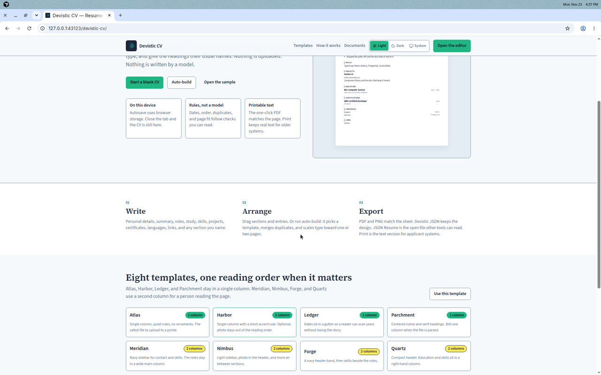
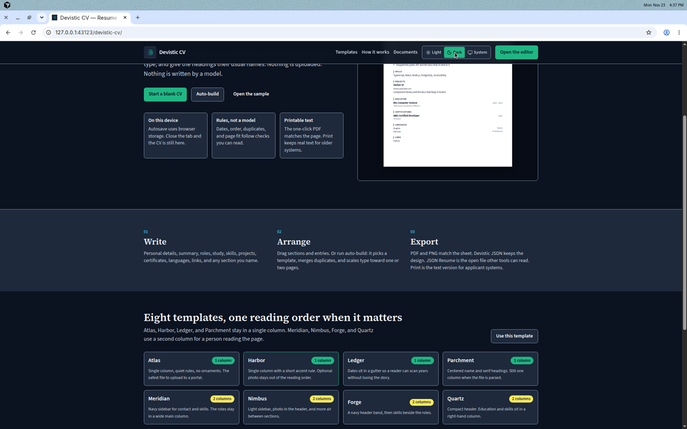
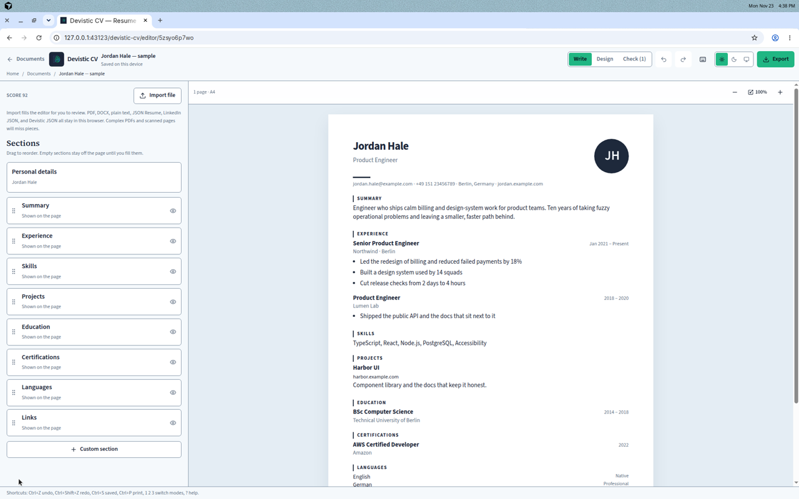
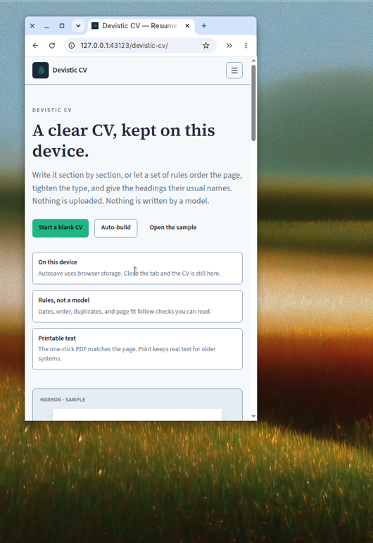

# Devistic CV

A private resume studio that runs in the browser. Write a CV, import one you already have, or let a set of rules arrange the page. There is no account, no analytics, and no writing model.

**Live:** [https://devistic-asim.github.io/devistic-cv/](https://devistic-asim.github.io/devistic-cv/)





## Features

- **Write.** Name and contact, a cropped photo, summary, experience, education, skills, projects, certifications, languages, links, and sections you name. Drag to reorder. Bold, italic, lists, and links in the text fields, with the browser spell checker left on.
- **Hints.** Each field explains what belongs there. A first-run tour and a checklist say which rule fired.
- **Auto-build.** A short form, or an uploaded file, picks a template, orders sections for the career stage, merges duplicates, normalizes dates, and scales type toward one or two pages.
- **Import.** PDF text (pdf.js), DOCX (mammoth), plain text, JSON Resume, a LinkedIn-style JSON export, or this app's own JSON. Parsing stays in the browser.
- **Eight templates.** Atlas, Harbor, Ledger, and Parchment are one column. Meridian, Nimbus, Forge, and Quartz use a second column. Accent, font, size, spacing, margins, date format, A4 or US Letter, photo shape, and sidebar side are editable. The sheet stays white paper in both app themes.
- **Check.** A fixed score for contact details, summary length, bullets, action verbs, metrics, dates, duplicates, and two-column risk. Paste a job post to see which of its words already appear. Nothing is rewritten.
- **Export.** Pixel-matched PDF and PNG, a text PDF via Print, Devistic JSON (design and photo included), and [JSON Resume](https://jsonresume.org/).
- **On this device.** Several CVs, autosave, undo, and redo. Data lives in `localStorage`. A job post pasted into Check lives in `sessionStorage` for that tab.

## How to use

1. Open the live site or run it locally.
2. Start blank, open the sample, auto-build, or import a PDF, DOCX, or JSON file.
3. Edit in Write. Switch templates and spacing in Design. Read Check before you export.
4. Download a PDF for a person, or use Print when an applicant system needs selectable text. Single-column templates are the safer choice for older systems.
5. Download Devistic JSON if you want a full copy, including the photo and template. Download JSON Resume if another tool should read the file.





## Tech stack

React 19, TypeScript, Vite, Tailwind CSS 4, React Router, Zustand. PDF text via pdf.js, DOCX via mammoth, page images via html-to-image and jsPDF. Fonts are bundled. There is no backend.

## Run locally

```bash
npm install
npm run dev
```

The app is served at [http://127.0.0.1:43123/devistic-cv/](http://127.0.0.1:43123/devistic-cv/). The `/devistic-cv/` base matches GitHub Pages.

```bash
npm run lint
npm test
npm run build
npm run preview
```

## Privacy

We don't use cookies for tracking and we don't collect or store your data on any server. Everything stays in your browser on this device.

A notice says this on the first visit. Dismissing it is remembered in `localStorage`. **Clear my local data** removes saved CVs, the theme choice, and that dismissal. Photos and documents can fill the browser's storage quota. Export JSON before you clear a browser profile.

## Deploy

Pushes to `main` run [`.github/workflows/deploy.yml`](.github/workflows/deploy.yml). The workflow builds with base `/devistic-cv/`, copies `index.html` to `404.html` so client routes resolve, and deploys with GitHub Pages actions.

The repository owner must set **Settings → Pages → Build and deployment → Source** to **GitHub Actions** before the first deploy can publish.

## Contributing

See [CONTRIBUTING.md](CONTRIBUTING.md) and the [Code of Conduct](CODE_OF_CONDUCT.md).

## License

[MIT](LICENSE) © devistic-asim

## Contact

https://github.com/devistic-asim
